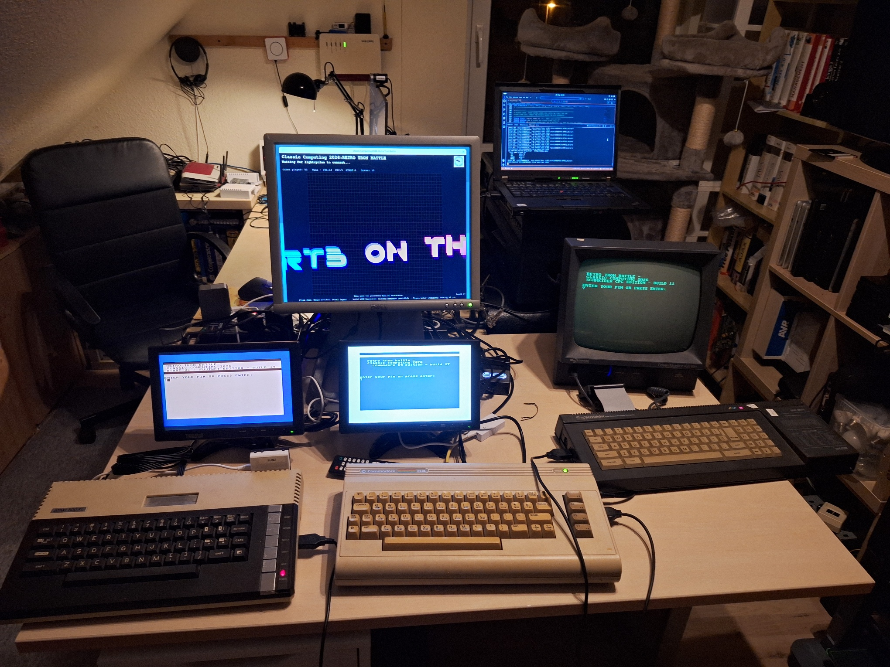
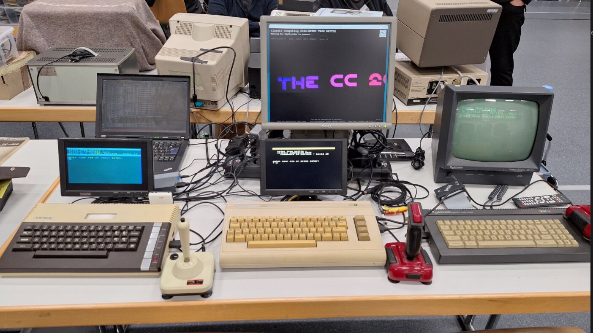

# Retro Tron Battle

A network lightcycle duel for real retro computers (Atari XL/XE,
Commodore 64, Schneider/Amstrad CPC) with server-side rendering — built
for [Classic Computing 2026](https://www.classic-computing.de/cc2026/)
in Celle (10–11 October 2026).



*The test setup: Atari XL with FujiNet, Commodore 64 with Meatloaf and
Schneider CPC with M4 board, each waiting at the PIN prompt — the
server's waiting screen in the middle.*

Detailed background, design decisions, and hard-won platform quirks
live in [`CLAUDE.md`](./CLAUDE.md) — please read it before making
bigger changes.

## Setup example: Classic Computing 2026



*The stand at Classic Computing 2026 in Celle. In front, from left: the
Atari XL with FujiNet, the Commodore 64 with Meatloaf and the Schneider
CPC with M4 board, each with its own joystick and screen. In the middle
is the server display with the waiting screen, and behind it the
notebook that runs the server.*

If you want to run Retro Tron Battle at your own retro computer event,
this is all you need:

- **Two or more retro computers** with a WiFi interface (see
  [Hardware interfaces](#hardware-interfaces)). Each one needs its own
  screen and joystick.
- **One computer for the server** (any machine with Python 3 and
  pygame; a notebook is fine) plus **a big screen** for the playfield.
  Visitors watch the battle there, not on the retro screens.
- **Your own WLAN router**, see below.

### Network: bring your own WLAN

At Classic Computing 2026 the setup ran on its own WLAN from a
FRITZ!Box rather than the hall WiFi. All the retro computers and the
server joined this private network, and all 133 matches of the event
ran over it.

The FRITZ!Box connected to the exhibition network as its WAN side and
did NAT. That way the server could still fetch the visitor photos
(JPGs, `PHOTO_SOURCE = "HTTP"`, `HTTP_PHOTO_BASE_URL`) from the event's
photo server, for the intro screen before each battle and the side
panel during it. The retro clients only ever talk to the server inside
the private WLAN.

The WLAN channel was left on automatic, because the hall was full of
hotspots from visitors' smartphones and the FRITZ!Box can move away
from busy channels by itself. The box stood right next to the retro
computers, and with that strong signal it was a rock-solid access
point for the whole event.

We recommend the same for events: hall WiFi quality is unknown in
advance, and it can be crowded. With your own router the SSID, the IP
addresses (give the server a fixed one; the clients have it in their
config blocks) and the round trips (see the latency equalizer in
`CLAUDE.md`) stay the same as at home.

## CC2026 results

From Thursday evening (setup, 8 October) to Sunday afternoon the
server logged **133 matches**, all on the real Atari XL, C64 (Meatloaf)
and Schneider CPC. In **80 of them both players actually steered**. In
the rest, at least one player didn't steer at all and their bike rode
straight into the wall. The busiest hour was Sunday 13:00–14:00 with
15 matches.

| Pairing (both steering) | Matches | Atari | C64 | CPC | Draw |
|---|---:|---:|---:|---:|---:|
| Atari vs C64 | 49 | 31 | 17 | – | 1 |
| C64 vs CPC | 23 | – | 8 | 15 | – |
| Atari vs CPC | 8 | 6 | – | 2 | – |

A battle lasted about 22 s at the median (including the ~7.6 s
countdown), and the longest took 61 s.

The dynamic latency equalizer measured the clients itself in 126 of
the 133 matches. On the event WLAN the C64 polled about every 338 ms
and the CPC about every 69 ms, both close to the values from home. The
faster player was therefore held back by a median of +251 ms (Atari)
or +207 ms (CPC). Even so, the C64 lost about two thirds of its real
battles. Occasional Meatloaf hiccups (about 1 % of polls took around
1.5 s or longer) may play a part, but with constantly changing players
the sample is small.

## Hardware interfaces

Each of the retro computers connects to the server over a WiFi
interface:

- **Atari XL/XE:** [FujiNet](https://fujinet.online/)
- **Commodore 64:** [Meatloaf](https://github.com/idolpx/meatloaf)
  (standard client) or [WiC64](https://www.wic64.de/) (experimental)
- **Schneider/Amstrad CPC:** [M4 Board](https://www.cpcwiki.eu/index.php/M4_Board)

## Quickstart

```bash
pip install pygame
python3 server/tron_server.py [host] [tcp_port] [http_port]
# Defaults: 0.0.0.0 6502 8080
```

The server window shows the playfield, visitor photos, logos, and a
demo scroll text while waiting for players.

## Project structure

```
server/     The Python server (game logic + pygame display)
clients/    BASIC clients per platform
  atari/    Atari XL/XE + FujiNet (raw TCP)
  c64/      Commodore 64 - two variants:
              tron_c64_client.bas       (Meatloaf, HTTP polling, stable)
              tron_c64_wic64_client.bas (WiC64, experimental)
  cpc/      Schneider/Amstrad CPC + M4 board (HTTP polling)
  apple2/   Apple II + FujiNet (raw TCP) - experimental, unverified,
            see CLAUDE.md
bots/       Automated test bots (Bash/PowerShell) to play without
            real hardware, e.g. for demos or load tests
tools/      Diagnostic/test programs per platform, plus links to
            external third-party tools (d64-inspector, C64 TrueType
            font) - see README there
docs/       PDF documentation (protocol, extending to further platforms,
            hardware test checklist, PAP flowcharts for explaining the
            game to visitors)
disk-images/ Ready-made reference disk images (Atari/CPC/C64) for
            setting up real hardware, see README there
archive/    Abandoned approaches, kept for reference
```

## Setting up clients

Each `.bas` client has a short config block right at the top (server
IP, port, player name) — edit before use. The WiC64 client
(`clients/c64/tron_c64_wic64_client.bas`) additionally needs the file
`FOTOFIX.C000` (WiC64 driver by Andreas Beermann) on the same disk. It
is **not included** in this repo, see
[`clients/c64/wic64-driver/`](./clients/c64/wic64-driver/).

## Server configuration

All settings (photos/FTP/HTTP, logos, scroll text, playfield size,
speed) are clearly marked blocks at the top of
`server/tron_server.py` — edit them directly there, no separate
config file.

## Thanks

Hans has developed the fotofix idea - many thanks from here!

## License

The project's own code and documentation are under the [MIT License](./LICENSE).
Not covered by it: the manufacturer, club and project logos in
`assets/logos/` (trademarks of their owners), and the third-party
programs on the Atari disk images (FujiNet tools, Atari DOS 2.0S). The
"Flynn" scroll font and the WiC64 driver `FOTOFIX.C000` are not
included at all, see `assets/README.md` and
`clients/c64/wic64-driver/README.md`.

## AI notice

This project was developed with AI assistance (Claude) — the server
permanently shows a corresponding notice in the footer.
